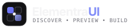

<div align="center">
  
  <p><strong>Discover. Preview. Build.</strong></p>
  <p><em>The Premier Open-Source UI Component Marketplace & Developer Resource Library</em></p>

  <p>
    <a href="#features-overview">Features</a> •
    <a href="#getting-started">Getting Started</a> •
    <a href="#marketplace-hubs">Marketplace Hubs</a> •
    <a href="#preview-engine-architecture">Preview Architecture</a> •
    <a href="#verification-suites">Verification</a> •
    <a href="#documentation">Docs</a> •
    <a href="#license">License</a>
  </p>
</div>

---

## Overview

**ElementraUI** is a modern, developer-first UI component discovery platform, design-engineering marketplace, and offline-capable resource library.

Built for frontend engineers and design technologists, ElementraUI indexes over **6,750+ verified components, themes, templates, runnable mini-apps, vector icons, and motion engineering loops**. It delivers live isolated in-browser React sandboxes, secure sandboxed HTML snapshots, CSS variable palettes, and direct 1-click CLI scaffolding commands.

---

## Features Overview

1. **Components Discovery (6,753 Master Records)**:
   - **162 Core Curated Components**: 14 standalone React 19 / Framer Motion / Three.js implementations with dynamic in-browser compilation (Sucrase) + 138 CLI registry blueprints.
   - **6,591 Community Components**: Mirrored on disk with non-empty HTML DOM snapshots (`rendered.html`), PNG reference screenshots, and AI prompt instructions.
   - **Multi-Faceted Discovery**: Real-time filtering by category, author, source repository, content type, motion engine, and artifact flags.
2. **Themes Marketplace (8 Production Palettes)**:
   - Full CSS variable token systems: *Zinc Modernist*, *Cyber Neon*, *Midnight Obsidian*, *Emerald Clean*, *Sunset Amber*, *Nord Glacier*, *Retro Terminal*, *Tokyo Night*.
   - Live color swatch previewers, 1-click CSS variable copying, and direct "Apply to Website Builder" integration.
3. **Templates Starter Hub (6 Full Starters)**:
   - Complete multi-page blueprints: *DevTool SaaS Starter*, *Bento Portfolio Engine*, *Cloud Analytics Dashboard*, *Agency Creative Studio*, *AI Agent Canvas Hub*, *Docs & Handbook*.
   - Multi-viewport switcher (Desktop 100%, Tablet 768px, Mobile 390px), interactive file tree visualizer, and CLI scaffolding.
4. **Runnable Mini-Apps (6 Sandboxed Tools)**:
   - Real, executable client-side React tools: *Agile Kanban Board*, *Live Markdown Editor*, *Pomodoro Focus Timer*, *Programmer Calculator*, *JSON Formatter & Validator*, *Color Palette Generator*.
5. **Vector Icons Studio (20 Vector Suites)**:
   - Searchable SVG icon discovery workspace with real-time Size (16–64px) and Stroke (1–3px) sliders.
   - 1-click export to raw SVG, React JSX, download `.svg`, or "Insert into Builder".
6. **Video & Motion Engineering (6 Motion Loops)**:
   - High-frame-rate visual loops (Canvas 60fps, CSS keyframe gradients, Three.js WebGL, 3D cubes) with Remotion compositions and CSS source code.
7. **Universal Bookmarks & Collections**:
   - Cross-section collection boards with zero-data-loss migration from legacy favorites, custom boards, and JSON backup export/import.
8. **Omnibox Global Search (`Cmd+K` / `Ctrl+K`)**:
   - Universal search dialog indexing all 7 marketplace sections simultaneously with keyboard navigation.
9. **Developer Studios**:
   - **AI Prompt Studio**: Interactive prompt engineering with system instructions, target tool optimizers (Cursor, Claude Code, Windsurf, v0), and prompt blueprints.
   - **Website Builder**: Visual canvas builder with drag-and-drop elements and live theme injection.

---

## Getting Started

### Prerequisites
- **Node.js**: v18.0.0 or higher (v20+ recommended)
- **npm**: v9.0.0 or higher

### Installation

```bash
# Clone the repository
git clone https://github.com/elementraui/elementraui.git
cd elementraui

# Install dependencies
npm install
```

### Local Development Server

```bash
npm run dev
```

Open [http://localhost:5173/](http://localhost:5173/) in your browser.

### Production Build

```bash
# Typecheck and build optimized bundle
npm run build

# Or build with static asset bundling for standalone static hosting
npm run build:static

# Preview the production build locally
npm run preview
```

---

## Preview Engine Architecture

ElementraUI guarantees **Honest Capabilities & Zero Visual Faking**. Every preview is dynamically routed through an isolated execution sandbox based on physical asset evidence:

```
                            ┌─────────────────────────┐
                            │      CatalogueItem      │
                            └────────────┬────────────┘
                                         │
                                         ▼
                            ┌─────────────────────────┐
                            │      PreviewEngine      │
                            │  (Capability Dispatch)  │
                            └────────────┬────────────┘
                                         │
        ┌──────────────┬─────────────────┼─────────────────┬──────────────┐
        ▼              ▼                 ▼                 ▼              ▼
┌──────────────┐┌──────────────┐  ┌──────────────┐  ┌──────────────┐┌──────────────┐
│IsolatedReact ││ StaticHtml   │  │  Blueprint   │  │  Theme &     ││  Screenshot  │
│  Renderer    ││   Renderer   │  │   Renderer   │  │ Template     ││   Renderer   │
│(Sucrase + R19││(Offline TW + │  │(CLI Registry/│  │  Renderers   ││ (Explicit    │
│ bundled deps)││Mock Storage) │  │Prompt Studio)│  │ (Swatches/VP)││  Reference)  │
└──────┬───────┘└──────┬───────┘  └──────┬───────┘  └──────┬───────┘└──────┬───────┘
       │              │                  │                 │               │
       └──────────────┴──────────────────┼─────────────────┴───────────────┘
                                         ▼
                            ┌─────────────────────────┐
                            │  PreviewErrorBoundary   │
                            │ (Fault & Crash Trap)    │
                            └─────────────────────────┘
```

- **Isolated React Sandbox**: Compiles arbitrary TSX/JSX in the browser via `sucrase` and mounts it inside an iframe loaded with offline bundled React 19, Framer Motion, and Three.js (`/vendor/isolated-react-runtime.js`, 1.96 MB).
- **Strict Iframe Sandbox**: All HTML snapshots run with `sandbox="allow-scripts"` (strictly omitting `allow-same-origin`), preventing third-party code from accessing parent cookies or local storage.
- **In-Memory Storage Mock**: Injects a safe in-memory polyfill for `localStorage` and `sessionStorage`, preventing `DOMException: SecurityError`.
- **Fault Isolation**: The React `PreviewErrorBoundary` traps runtime crashes and WebGL context errors without impacting navigation or search.

---

## Verification & Quality Assurance Suites

ElementraUI includes 8 automated test suites totaling **548 automated checks** (100% passing):

```bash
# Run real Playwright Chromium headless test on 8 representative categories
npm run test:live

# Run real Playwright Chromium audit across 54 representative items
npm run test:browser

# Verify all 7 marketplace sections and data schemas (75 tests)
npm run test:marketplace

# Verify core React implementations and JSON registry endpoints (59 tests)
npm run test:previews

# Verify community HTML snapshots, PNG magic headers, and prompts (112 tests)
npm run test:awesome

# Verify HTTP status codes and payload sizes (381 tests)
npm run test:coverage

# Verify CLI component installation into a test project (6 tests)
npm run test:install

# Run dataset health audit
npm run audit:coverage
```

---

## Documentation

Full architectural and developer documentation is available in the [`docs/`](docs/) directory:
- [docs/ARCHITECTURE.md](docs/ARCHITECTURE.md) — System architecture, navigation, and technology stack.
- [docs/PREVIEW_ARCHITECTURE.md](docs/PREVIEW_ARCHITECTURE.md) — Isolated execution pipelines and security sandboxing.
- [docs/CATALOGUE_SCHEMA.md](docs/CATALOGUE_SCHEMA.md) — TypeScript data contracts and item models.
- [docs/ADDING_RESOURCES.md](docs/ADDING_RESOURCES.md) — Step-by-step guide to contributing components and themes.
- [docs/DEVELOPMENT.md](docs/DEVELOPMENT.md) — Local development workflow and scripts.
- [docs/TESTING.md](docs/TESTING.md) — Quality assurance guide and Playwright standards.
- [docs/SECURITY.md](docs/SECURITY.md) — Security policies, iframe isolation, and vulnerability disclosure.
- [docs/KNOWN_LIMITATIONS.md](docs/KNOWN_LIMITATIONS.md) — Technical constraints and boundaries.
- [docs/CHANGELOG.md](docs/CHANGELOG.md) — Version release history and migration log.

---

## License

This project is licensed under the **MIT License** — see the [LICENSE](LICENSE) file for details.

Components and assets indexed from the open-source community preserve their original authors' licenses (MIT, Apache-2.0, ISC). See individual component provenance records for upstream details.
